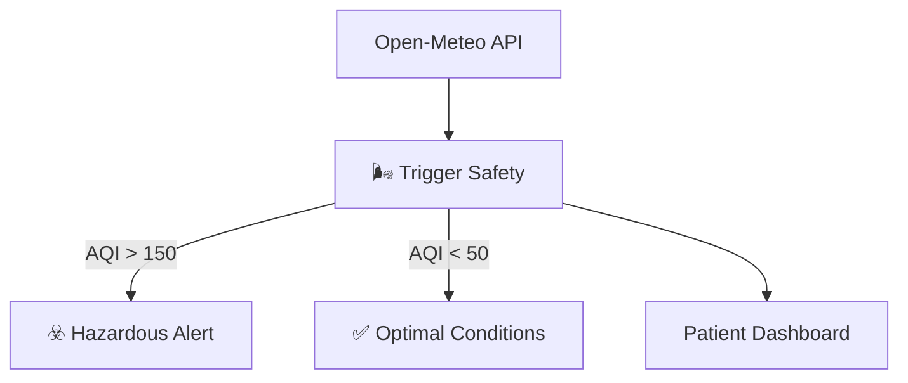

<div align="center">

</div>

# BreathEasy AI

**Predictive Asthma Management & Environmental Risk Intelligence**

BreathEasy AI is a forward-looking "Digital Pneumology" platform designed to align with Sword Health's ecosystem. It shifts asthma care from **Reactive** (using rescue inhalers) to **Predictive** (dodging triggers) by analyzing environmental data relative to patient sensitivity.

## 🚀 Live Demo

**Production**: [https://breatheasy-ai-demo.vercel.app](https://breatheasy-ai-demo.vercel.app)

## 📄 Clinical Documentation
> **Medical Logic Verified**: Uses **Lagged Risk Modeling** (Day 0 Exposure -> Day 2 Risk) to predict inflammation latency, aligning with proactive management principles.
>
> 👉 [**View Full Product Requirements (PRD)**](../../project-2-prd/BreathEasy-AI-PRD.md)

## ✨ Key Features

### 1. **Lagged Risk Engine** ⭐ NEW
- **The Problem**: High Ozone today causes attacks *tomorrow*. Standard apps miss this.
- **The Solution**: A multi-day "Risk Horizon" algorithm that warns patients of delayed inflammatory effects.

### 2. **Environmental Intelligence**
- Real-time AQI, Pollen, and Weather data via Open-Meteo.
- "Safe Run" planner for outdoor activities.

### 3. **Smart Trigger Guardrail**
- **Safety First**: Deterministic checks for hazardous conditions (AQI > 150).
- **Visual Feedback**: Simple "Traffic Light" system (Green/Yellow/Red) for action plans.

## 🏗️ Architecture
The **BreathEasy System** uses a Trigger Safety Guardrail to deterministic flag hazardous environmental conditions.



## 🛠️ Tech Stack

- **Frontend**: React 19 + TypeScript
- **Build Tool**: Vite 6
- **Styling**: Tailwind CSS
- **API**: Open-Meteo (Weather/Air Quality)
- **Deployment**: Vercel

## 🏃 Run Locally

1. **Install dependencies**:
   ```bash
   npm install
   ```

2. **Run the app**:
   ```bash
   npm run dev
   ```

## 📝 License

MIT License - see the [LICENSE](../LICENSE) file for details.

---

**Built by Francisco Pinheiro** | [LinkedIn](https://linkedin.com/in/fmmpinheiro)
